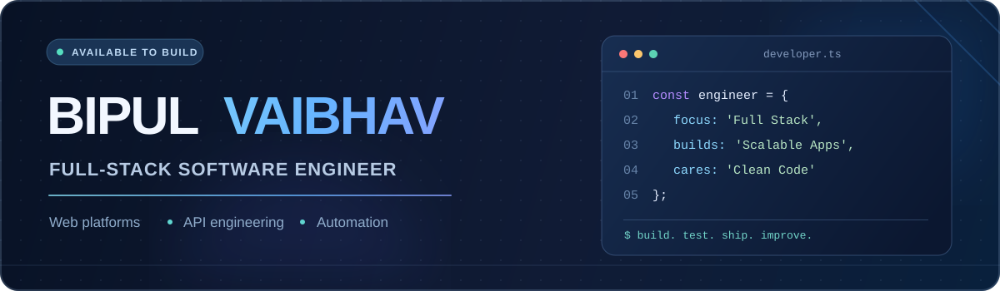

<!-- Custom GitHub profile for https://github.com/bipulvaibhav007 -->

  

   

  
  
  

    

  

## A little about me

I'm **Bipul Vaibhav**, a software engineer with **4+ years of experience** developing websites, web applications, APIs, and business tools. I enjoy building practical products that are fast, maintainable, and pleasant to use — from polished frontends to reliable backend systems.

- **I build:** full-stack applications, SaaS platforms, dashboards, e-commerce experiences, and automation tools.
- **I work with:** JavaScript / TypeScript, React, Next.js, Node.js, PHP, Laravel, Python, and relational databases.
- **I'm exploring:** NestJS, scalable system design, developer tooling, and AI-assisted workflows.
- **My approach:** thoughtful UI, clean code, performance, security, and real-world usability.

## Tech I work with

**Frontend & UI**

**Backend & frameworks**

**Data & tooling**

## Selected public repositories

| Project | Overview | Technology |
|:--|:--|:--|
| [**Career Boss**](https://github.com/bipulvaibhav007/career-boss) | Web application project | `PHP` |
| [**FastAPI Blog**](https://github.com/bipulvaibhav007/fastapi-blog) | Blog API project | `Python` / `FastAPI` |
| [**Mobile Info Tool**](https://github.com/bipulvaibhav007/mobile-info-tool) | Developer utility | `Python` |
| [**Lead Sniper**](https://github.com/bipulvaibhav007/lead-sniper) | Python project | `Python` |

> More selected professional work and projects: **[vaibhavalgo.in](https://vaibhavalgo.in/)**. Some client and commercial repositories are private.

## GitHub at a glance

  
  

  

  

## Let's build something useful

I like working on meaningful products, solving challenging development problems, and making good software easier to use.

**Explore my work:** [Portfolio](https://vaibhavalgo.in/) · [Repositories](https://github.com/bipulvaibhav007?tab=repositories)

  Built with curiosity, care, and a commitment to shipping quality software.

